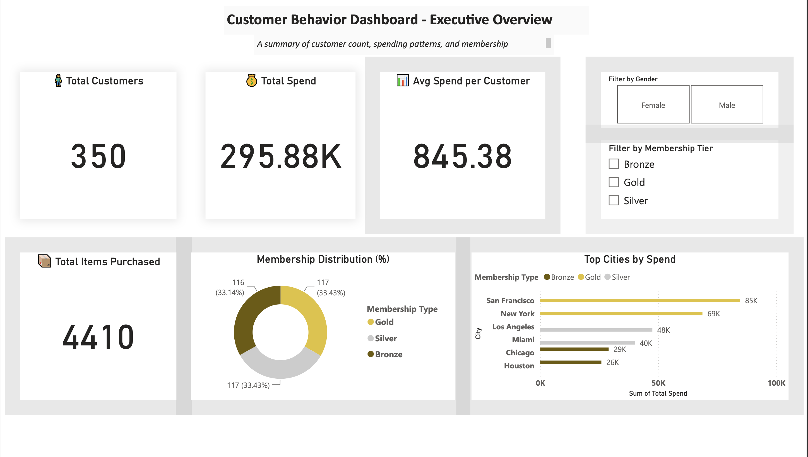
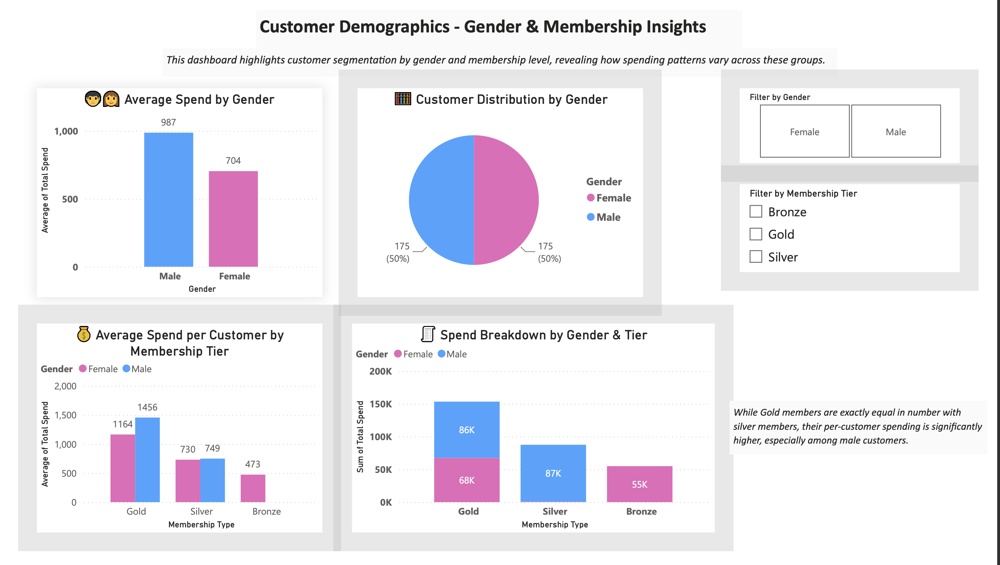
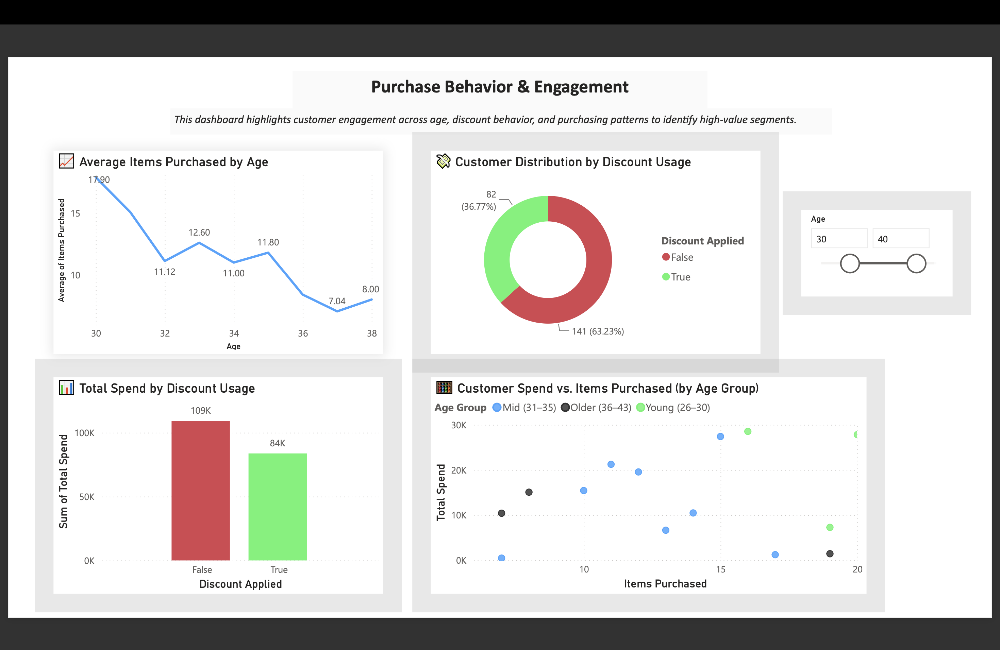
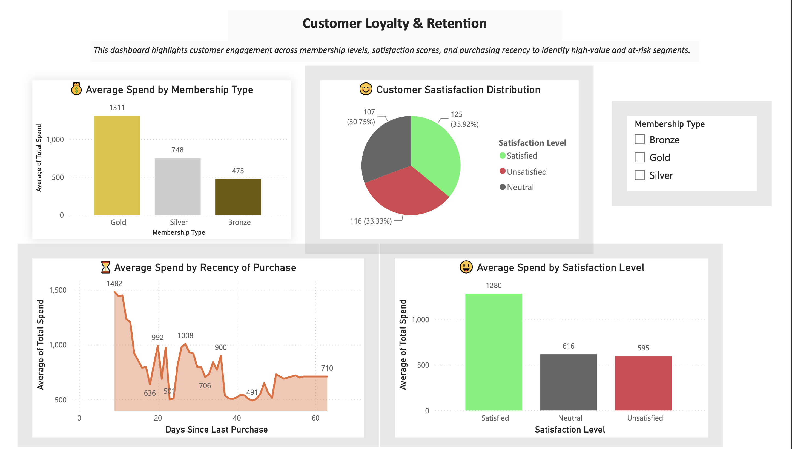
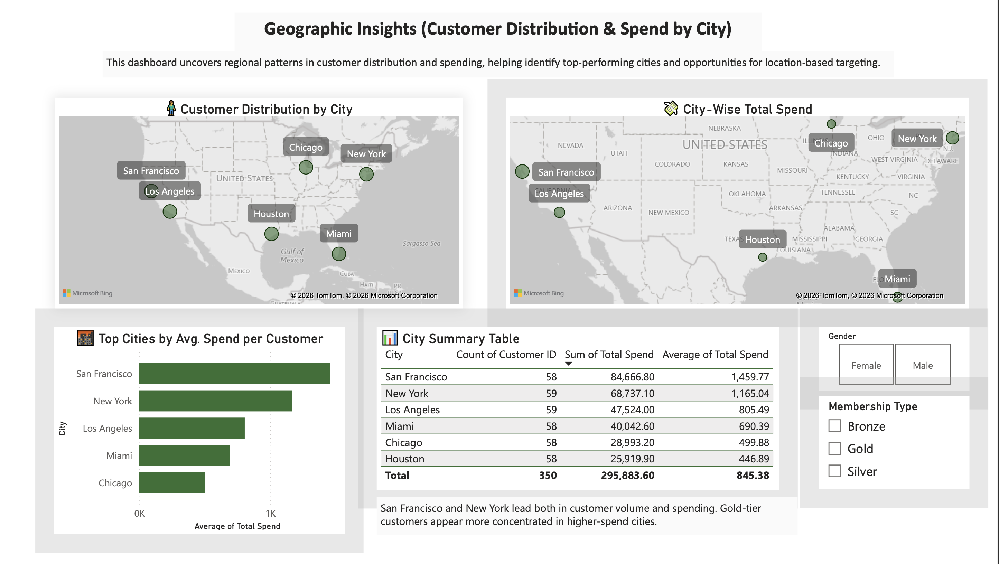
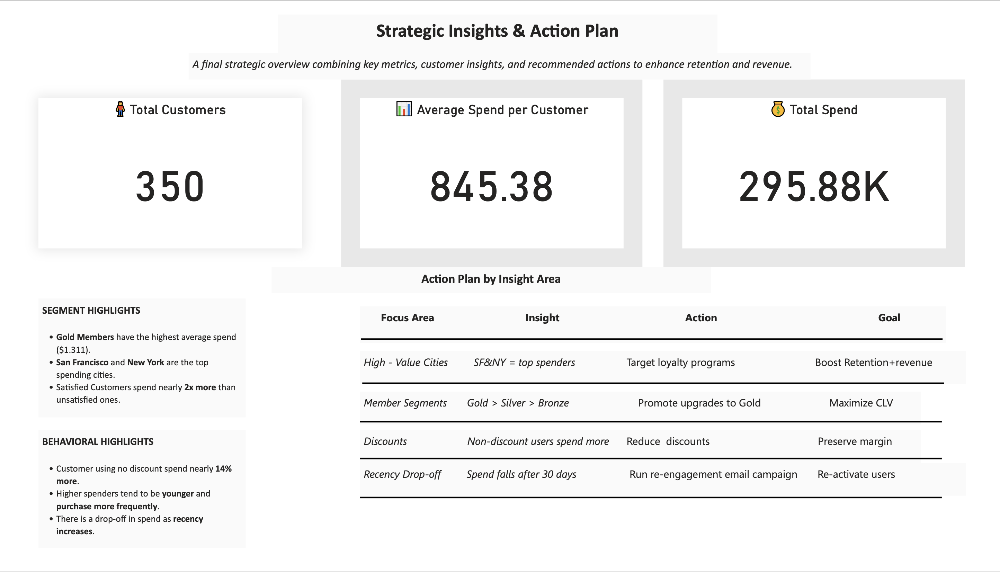

# Ecommerce-Customer-Behavior-Analysis
E-commerce customer behavior analysis and interactive dashboard developed using Power BI.
This project was developed as part of a university Business Intelligence course. The goal was to analyze e-commerce customer behavior and transform data into meaningful insights through interactive Power BI dashboards.

Tools & Technologies: Microsoft Power BI, Data Visualization, Business Intelligence

The project consists of six dashboard pages exploring customer purchasing patterns, spending behavior, and key business metrics.

## Dashboard Preview

### Page 1

### Page 2

### Page 3

### Page 4

### Page 5

### Page 6

